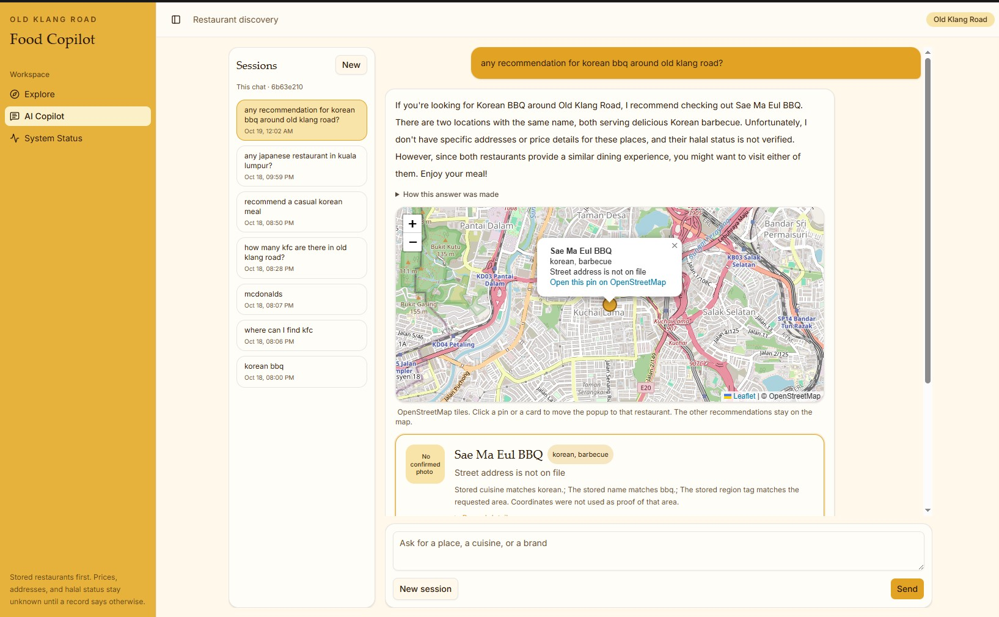
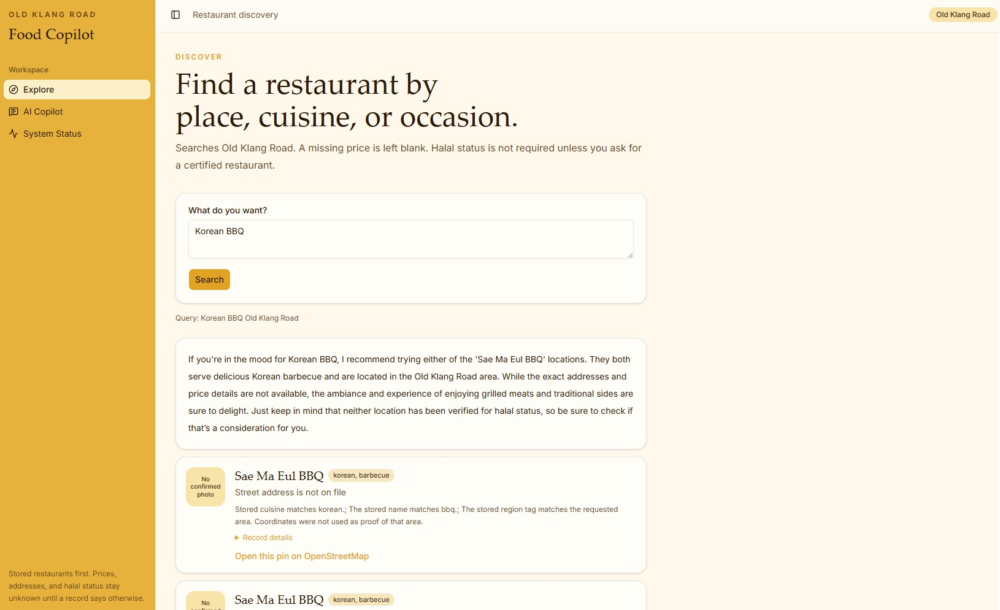
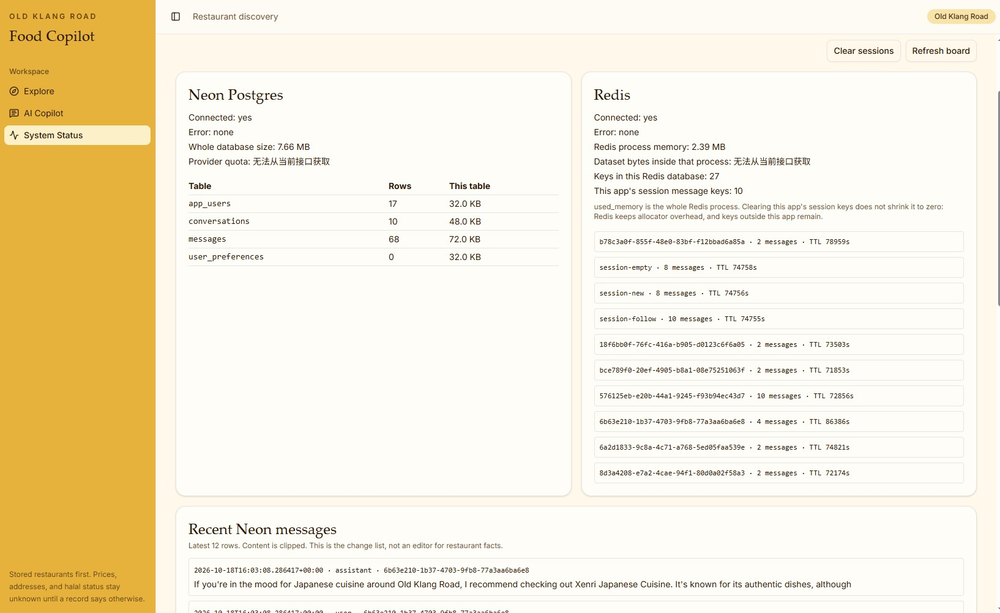

# Malaysia Food Copilot

Multi-agent restaurant discovery for **Old Klang Road**, with an explicit Kuala Lumpur search when the user names that city.

A request goes through a language-model intent step, a real MCP tool loop, a ranking pass, and a final synthesis. Restaurant cards still come from the stored OpenStreetMap records. The model may explain those records. It does not invent restaurants, prices, addresses, hours, reviews, or URLs.

旧巴生路是默认搜索范围。用户写明 Kuala Lumpur 或 Kulim 时按原话搜索。没有来源的价格、地址和清真状态保持未知。

## Screenshots

| Copilot | Explore | System status |
|---|---|---|
|  |  |  |

The Copilot screen shows the written recommendation, an OpenStreetMap pin, and the stored card. Diagnostic detail stays under **How this answer was made**.

## What it does

- Parses a sentence in English, 中文, or Bahasa Melayu.
- Searches Old Klang Road unless the sentence, or the current session, already names an area.
- Filters the canonical restaurant file before ranking. Budget, area, cuisine, brand, and verified-halal requests are hard constraints.
- Calls MCP tools for search and, when reviews are relevant, the pilot review corpus.
- Writes the final reply with a synthesis model. Unknown fields stay unknown.
- Draws map pins from stored coordinates. A pin is a location on file, not a verified street address.

## Architecture

```text
Vue  Explore / Copilot / Status
        |
        v
FastAPI  POST /api/chat
        |
        v
Agent workflow                         default on
  1. Intent          temperature 0.1   JSON plan, then parser lock
  2. Discovery       temperature 0.2   MCP tool loop, at most 3 rounds
  3. Ranking         temperature 0.2   reorder retrieved ids only
  4. Synthesis       temperature 0.7   the user-facing reply
        |
        +---- MCP stdio server
        |       search_restaurants
        |       get_restaurant_reviews
        |       details, evidence, preferences, session summary
        |
        +---- DiscoveryService
                hard constraints, then BM25 or baseline
                canonical JSON only
```

`ENABLE_AGENT_WORKFLOW` defaults to on. Tests set it to false so the older deterministic graph still has coverage. That older graph lives in `agents/discovery_graph.py` and is not the demo path.

The API process starts one stdio MCP server when the workflow is on and stops it on shutdown. `/health` reports the live MCP connection. An environment flag by itself is not reported as connected.

## Agents

| Step | Temperature | What it may do | What it may not do |
|---|---:|---|---|
| Intent | 0.1 | Return a JSON plan | Override a parsed budget, area, or exclusion |
| Discovery | 0.2 | Choose tools and arguments | Relax a hard constraint or create an id |
| Ranking | 0.2 | Reorder ids that were retrieved | Add an id that search did not return |
| Synthesis | 0.7 | Write the reply from the supplied facts | Add a restaurant, price, address, review, or URL |
| General QA | 0.5 | Answer a non-restaurant question | Run retrieval or invent a venue |

If the model key is missing or a call fails, the stored list is still shown and the reply is labeled as a fallback, not as a model recommendation.

## Grounding

| Situation | Behavior |
|---|---|
| No area named | Search Old Klang Road. Do not ask the user to choose a city. |
| Explicit Kuala Lumpur or Kulim | Keep that area. A follow-up in the same session inherits it. |
| Missing price | Leave it blank. Do not drop the restaurant for having no price. |
| Price verified and above the stated budget | Exclude it. |
| Halal not requested | Do not require a halal field. |
| Halal requested, no certification on file | Say unknown. Do not write "not halal". |
| Street address missing | Say it is not on file. Map pins may still use coordinates. |
| Web page | List it as a source. Do not insert it as a canonical restaurant. |
| Review quote | Only from the pilot corpus, and only for a confirmed `unique_name_in_area` match. Ordinary chat leaves review RAG off. |

Status words: `not_verified` means not checked, `unknown` means checked and still unsettled, `verified` means a source matches this business and has a URL. A search-result link is not verification.

## Stack

| Layer | Choice |
|---|---|
| Interface | Vue 3, Vite, TypeScript, Tailwind |
| API | FastAPI on `127.0.0.1:8767` |
| Orchestration | Multi-agent workflow in `src/food_copilot/agents/workflow.py` |
| Tools | MCP over stdio (`scripts/mcp_server.py`) |
| Retrieval | Hard filters, then BM25 when `ENABLE_BM25` is on |
| Model | OpenAI-compatible chat API. Default name `gpt-4o-mini` |
| Canonical data | `data/processed/restaurants.json`, 5,797 OSM records |
| Optional memory | Neon Postgres and Redis. The browser id is not an account |

## Quick start

The demo script sets the workflow, BM25, web search, and LangGraph for that process only. It does not edit `.env` and it does not load the removed demo dataset.

```powershell
powershell -File scripts/demo.ps1
```

In another terminal:

```powershell
cd frontend
npm install
npm run dev
```

Open [http://127.0.0.1:5173/copilot](http://127.0.0.1:5173/copilot). `GET http://127.0.0.1:8767/health` should report the canonical dataset, BM25 when that flag is on, and MCP from the live host rather than from the flag alone.

On this machine the API is started with the portable interpreter at `d:\project1\final-project\.python\python.exe`. Do not point the demo at that project's application code. The script inserts this repository and `src` onto `sys.path`.

Checks:

```powershell
$env:PYTHONUTF8 = "1"
d:\project1\final-project\.python\python.exe -m pytest tests -q --ignore=tests/integration/test_memory_roundtrip.py
```

`tests/conftest.py` forces `ENABLE_AGENT_WORKFLOW=false`. The memory roundtrip test writes Redis and Postgres, so leave it out of a normal run.

Try:

- `any recommendation for korean bbq around old klang road?`
- `how many kfc are there in old klang road?`
- `any japanese restaurant in kuala lumpur?`

## Configuration

Copy `.env.example` to `.env`. Do not commit `.env`.

| Variable | Role |
|---|---|
| `OPENAI_API_KEY`, `OPENAI_BASE_URL`, `OPENAI_MODEL` | Synthesis and the other model steps. Never sent to the browser. |
| `TEMPERATURE_INTENT` / `TOOLS` / `RANK` / `SYNTHESIS` / `GENERAL` | 0.1 / 0.2 / 0.2 / 0.7 / 0.5 |
| `ENABLE_AGENT_WORKFLOW` | Default on. Tests turn it off. |
| `ENABLE_BM25` | Rank eligible rows with BM25. The demo process turns this on. |
| `ENABLE_WEB_SEARCH` | Bing HTML sources. Not a restaurant insert. |
| `ENABLE_REVIEW_RAG` | Off for ordinary chat. |
| `ENABLE_LLM_AGENT` | Older two-agent graph. Demo leaves it off. |
| `DATABASE_URL`, `REDIS_URL` | Optional session memory. |
| `ALLOW_UNAUTHENTICATED_MEMORY` | Off unless a local `.env` turns it on. This is not login. |

`data/processed/restaurants.json` is the file the API reads. It is listed in `.gitignore`. A clone still contains the Old Klang Road and Kuala Lumpur processed subsets, raw OSM snapshots, and the review CSV corpus. Do not import `restaurants_final_verified_full.json`.

## Repository layout

```text
app.py                     FastAPI entry
frontend/                  Vue app: Explore, Copilot, Status
src/food_copilot/
  agents/workflow.py       intent, tools, rank, synthesis
  agents/mcp_host.py       stdio MCP client for the API process
  agents/discovery_graph.py
                           deterministic path used when the workflow is off
  mcp/                     tool server
  services/discovery.py    filters, ranking, cards
  retrieval/               constraints, BM25, web search
  data/repository.py       canonical JSON
  memory/store.py          optional Redis and Postgres
scripts/demo.ps1           local API
scripts/mcp_server.py      MCP stdio entry
docs/                      architecture, plan, and interface screenshots
```

## Documentation

| Document | Contents |
|---|---|
| [docs/architecture.md](docs/architecture.md) | Request path, components, state, failure behavior |
| [docs/architecture.mmd](docs/architecture.mmd) | Flowchart of the default path and the fallback |
| [docs/request-flow.mmd](docs/request-flow.mmd) | Sequence from the Copilot view to the cards |
| [PLAN.md](PLAN.md) | Current product rules, directory map, and remaining limits |
| [docs/verification-report.md](docs/verification-report.md) | Point-in-time verification notes |
| [docs/feature-matrix.md](docs/feature-matrix.md) | Feature inventory |

## Limits

- Most prices and halal fields are `not_verified`.
- Two OSM rows can share a name and still be different coordinates. They are separate records.
- Web search can return unrelated pages. Those pages stay in the source list.
- Evaluation queries do not have gold `relevant_restaurant_ids`, so Recall and NDCG are not reported as scores.
- Review vector indexes and hybrid embeddings stay off.
- The browser `user_id` is a local storage id, not an account.
- This is a local demonstration, not a production deployment.
